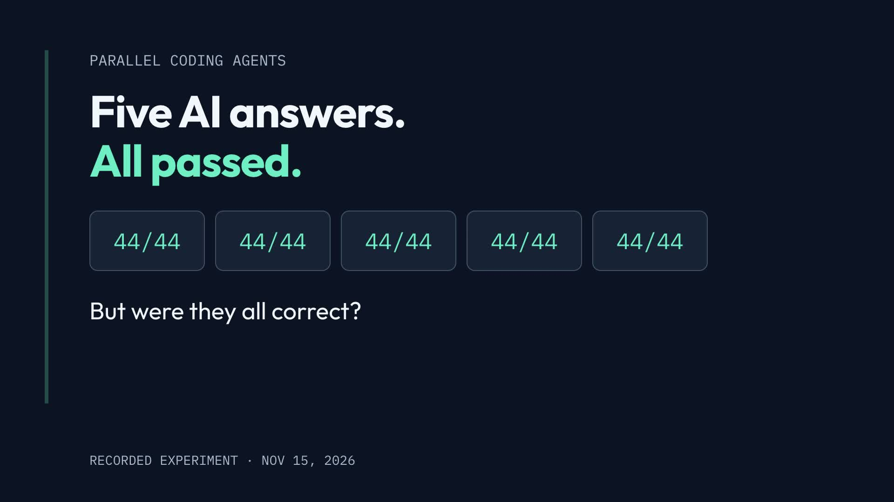

# All five AI solutions passed our original tests. Extra checks found bugs in two.

Five GPT models solved the same coding task in separate working folders. We have
now completed two assignments: money conversion and combining booking times. This
project keeps their drafts, checks their saved answers, and explains why we kept
one. **Explore a completed experiment for free—no API key needed.**

[Money evidence](examples/money-converter/README.md) ·
[Booking evidence](examples/bookings/README.md) ·
[Compare both](docs/EXPERIMENT_COMPARISON.md) ·
[Beginner guide](docs/BEGINNER_GUIDE.md) ·
[Why we chose the winner](solution/README.md) ·
[Challenge the answer](CONTRIBUTING.md)

## Watch the 25-second launch video

[](brag-output/brag.mp4)

[Play with voice-over](brag-output/brag.mp4) · [Read the narration](docs/DEMO_TRANSCRIPT.md) · [How we made it with Brag](brag-output/README.md)

A short animated explanation of the saved money-converter experiment, made with
Brag and Hyperframes. Includes an AI-generated voice and quiet music. No new GPT
requests were made. Read the booking experiment below for the second task.

## What happened in the money-converter experiment?

The assignment was a money converter: `₹500` becomes `50000` paise. All five
answers passed 40 hidden checks and four practice checks. Reading their code
suggested 22 more checks. Those exposed long-input and whitespace problems in
two answers.

**One task, one recorded run, November 15, 2026—not a general model ranking.**
Five failed checks do not mean five separate bugs. The three answers with no
observed failures are not proven correct for every possible input.

| Model | Model requests | Original checks | Additional review checks | Estimated cost for this run (USD) |
| --- | ---: | ---: | ---: | ---: |
| GPT-6 Astra | 2 | 44/44 | 22/22 | $0.07054 |
| GPT-6.1 Sol | 2 | 44/44 | 22/22 | $0.01468 |
| GPT-6.1 Terra | 3 | 44/44 | 22/22 | $0.01364 |
| GPT-6 Luna | 4 | 44/44 | 17/22 | $0.00204 |
| GPT-6 Sol | 2 | 44/44 | 17/22 | $0.01448 |

The race took 22.34 seconds with five overlapping requests. Total estimated
model cost was **$0.1153683**, using recorded standard uncached rates. These are
estimates, not a provider bill or a promise about another run. Attempts differed;
this is not a controlled price comparison. [Tokens, rates, and exact totals](examples/money-converter/run.json).

Astra, Sol 6.1, and Terra tied on observed checks. We chose **Astra** for its clear
single-function flow. This was an explicit code-review judgment, not automatic
winner selection. [Read the retained answer](solution/money.py).

## The second experiment: booking times

Combine bookings that overlap or touch. For example, `[[60, 120], [90, 150]]`
becomes `[[60, 150]]`, while the original list stays unchanged.

**All five passed all 48 prewritten cases.** The rules and assessment were frozen
before model requests. No post-hoc cases were added. Each model wrote one draft
and used two requests; the race took 12.84 seconds and cost an estimated $0.0655729.
Sol 6.1 was kept on a readability tie-break among the five passing answers.

[Simple step-by-step lesson](docs/BOOKING_EXPERIMENT.md) ·
[All five answers and evidence](examples/bookings/README.md) ·
[Kept booking solution](solution-bookings/README.md)

```sh
python3 -m bakeoff replay --task bookings
```

The first experiment exposed weaknesses through additional review; the second
ended in a five-way tie. [See both results without combining unlike tests into a ranking](docs/EXPERIMENT_COMPARISON.md).

## Explore it without installing anything

Start with the [browsable recorded experiment](examples/money-converter/README.md).
It includes every draft, final answer, original assessment, and additional review
case. Those original tests were hidden from the models while they wrote their
answers; they are now available for readers to inspect.

If Python is already installed, run this from the cloned repository folder:

```sh
python3 -m bakeoff replay
```

The replay uses only Python's standard library (Python 3.9+). It reads saved data;
it does not call OpenAI, load credentials, or execute candidate code. The recorded
labels are deliberate: this is a reconstruction from evidence, not a live race.

```sh
python3 -m bakeoff replay --lane lane-3  # See Terra's draft history
python3 -m bakeoff replay --demo         # Paced walkthrough, about 48 seconds
```

[Read the short demo transcript](docs/DEMO_TRANSCRIPT.md).

## Run the checks yourself

Executing generated code requires **macOS with `sandbox-exec`, Python 3.12+, and
Git**. There is no unrestricted fallback. Other systems can browse the example
and use the replay; they cannot use this sandbox backend.

```sh
python3.12 -m venv .venv
.venv/bin/python -m pip install -r requirements.txt
.venv/bin/python -m bakeoff sandbox-check
.venv/bin/python -m bakeoff recheck
```

`recheck` verifies the example's file fingerprints, then runs all 66 cases against
each of the five saved answers in fresh restricted processes. It makes no model
requests. It succeeds when the pass/fail results match the recording—including
the ten expected failed cases across Luna and Sol 6. A new report goes into
`workdir/`; the published evidence is not changed.

For the booking example, use `.venv/bin/python -m bakeoff recheck --task bookings`.
It runs 48 prewritten cases per candidate and makes no model requests.

To check the coordinator itself, run `.venv/bin/python -m pytest -q`.

## Start a new paid race

For a new race, put your own `OPENAI_API_KEY` in a local `.env` file, or export it
in your shell. Do not commit or share the key. Then:

```sh
.venv/bin/python -m bakeoff doctor
.venv/bin/python -m bakeoff race
```

You need access to the configured models. This makes billable API requests:
at most four per lane, 20 total, with a shared $2 **estimated** reservation guard.
It is not a guaranteed billing cap. The models may produce different answers.
Use `.venv/bin/python -m bakeoff race --task bookings` for a new booking race.
The coordinator supports these two explicit assignments; it is not a general tool
for fixing arbitrary repositories.

[Detailed setup and seven-step workflow](docs/BEGINNER_GUIDE.md).

## How it works, in plain English

1. **Set the rules.** Everyone gets the same assignment and practice questions.
2. **Give each model a desk.** Separate Git worktrees keep their files apart.
3. **Write, check, revise.** Each model receives its own practice feedback.
4. **Save the submitted answer.** A Git commit identifies its exact contents.
5. **Mark it outside the test room.** The coordinator compares candidate outputs
   with expected answers; printing “passed” cannot award a pass.
6. **Read and investigate.** Review-inspired tests are reported separately.
7. **Keep a reviewed answer.** Verify it again and preserve the alternatives.

The sandbox restricts files, network access, execution time, and output. It is a
local learning setup, not a hardened service for running arbitrary hostile code.
The unfinished `sample/` remains the starting assignment; `solution/` holds the
answer we kept.

## Can you break the winning answer?

Give us an input, the expected answer, the actual answer, and the assignment rule
that supports your expectation. [Contribution guide](CONTRIBUTING.md).

You can also suggest a useful next assignment or help make an explanation
clearer. [Completed second experiment](docs/BOOKING_EXPERIMENT.md) ·
[Feedback and release checklist](docs/LAUNCH_CHECKLIST.md).

If this helps you understand or evaluate AI coding agents, consider starring the
repository so you can find it again.
